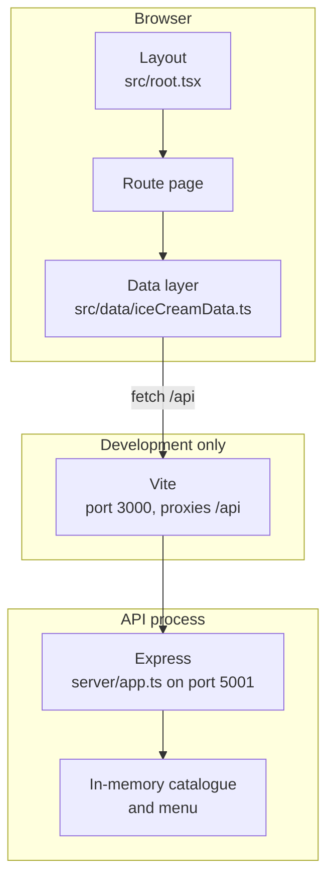
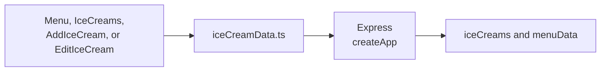
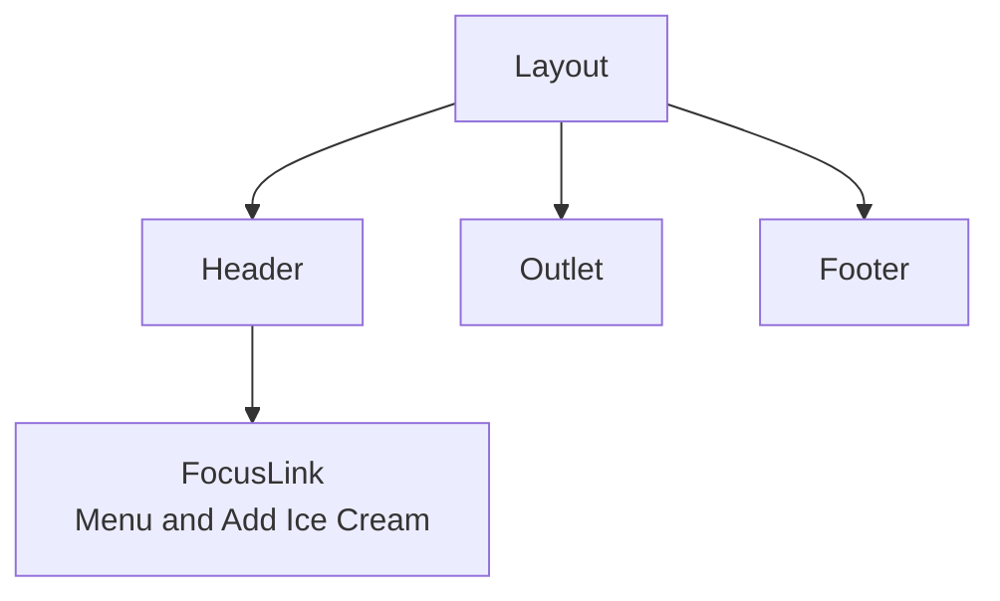
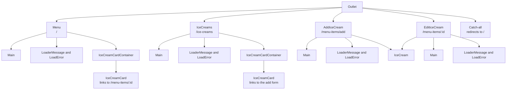
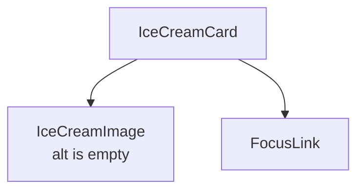
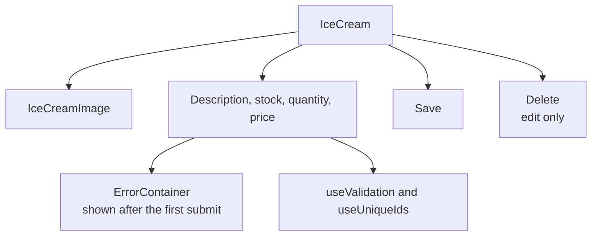

# Architecture

How the ice cream menu app is put together. The decisions behind these choices are in [architecture-decision-records.md](architecture-decision-records.md).

The browser shows a client-rendered single-page app. Pages load and save through one data module. That module calls the Express API. In development, Vite on port 3000 proxies `/api` to Express on port 5001. The API keeps the menu in memory, so a restart restores the seed menu.

`npm run build` writes the SPA to `build/client`. The production browser still calls `/api`, and Express still serves it. The Vite proxy exists only while `npm start` is running.

## Routes

`src/routes.ts` maps each URL to one page. Anything else redirects to `/`.

| URL                            | Page           | What it loads                                   |
| ------------------------------ | -------------- | ----------------------------------------------- |
| `/`                            | `Menu`         | Menu items, sorted by name on the client        |
| `/ice-creams`                  | `IceCreams`    | Catalogue flavours that are not on the menu yet |
| `/menu-items/add?iceCreamId=N` | `AddIceCream`  | One catalogue flavour, then creates a menu item |
| `/menu-items/:menuItemId`      | `EditIceCream` | One menu item, then updates or deletes it       |
| anything else                  | catch-all      | Redirects to `/`                                |

`/api/menu/stock-ice-creams` is registered before `/api/menu/:id`, so the catalogue is not treated as a menu-item id.

## Request path

Pages never call `fetch`. They call `src/data/iceCreamData.ts`, and that module is the only place that does.

| Client function  | Request                              | Server behaviour                                                                |
| ---------------- | ------------------------------------ | ------------------------------------------------------------------------------- |
| `getMenu`        | `GET /api/menu`                      | Returns the menu. The client sorts it by name.                                  |
| `getMenuItem`    | `GET /api/menu/:id`                  | Returns one item, or 404.                                                       |
| `postMenuItem`   | `POST /api/menu`                     | Creates an item. The stored name comes from the catalogue, not from the client. |
| `putMenuItem`    | `PUT /api/menu/:id`                  | Replaces an item. The stored name again comes from the catalogue.               |
| `deleteMenuItem` | `DELETE /api/menu/:id`               | Removes an item.                                                                |
| `getIceCreams`   | `GET /api/menu/stock-ice-creams`     | Catalogue flavours missing from the menu.                                       |
| `getIceCream`    | `GET /api/menu/stock-ice-creams/:id` | One catalogue flavour.                                                          |

A non-2xx response rejects with `error.status`. Loading effects pass an abort `signal` and cancel it on cleanup. A failed load shows a `role="alert"`. A failed save or delete leaves the form on screen and shows an alert. After a successful save or delete, the page returns to `/` and the menu heading takes focus.

The server does not validate the form. Description, price, and the quantity/stock coupling are checked in the browser by `useValidation` and `src/utils/validators.ts`, and the errors appear after the first submit.

## Component tree

`Layout` is the shell on every page. `Outlet` is the route page.

Each page renders `Main`, which is the `<main id="main">` landmark, the document title, and the heading. `LoaderMessage` announces loading. `LoadError` is the alert.

A card is the image, a `FocusLink`, and, on the menu, the price, stock, and description.

`IceCream` is the shared form. Add passes `onSubmit`. Edit also passes `onDelete`.

