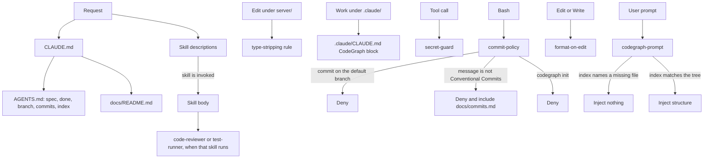

# Claude configuration

What loads on a request, and what stays quiet until something happens. `CLAUDE.md` points here through `docs/README.md`. It does not import this page.

`AGENTS.md` is the process gate. The standing checks are `docs/DoD.md`. A spec can add a check. Skill bodies, the two agents, and the type-stripping rule load only when they are used. The hooks stay silent unless they deny a call or the index matches the tree.
